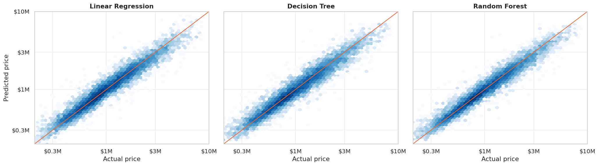

# California Home Price Prediction

Predicting the sale price of single-family homes in California from MLS sold records. Built during the IDX Exchange Data Science Internship.

The model is designed to value **any** single-family address, whether or not it is on the market. It uses only information that would be known about a property before it sells, so asking price, days on market and other listing-process fields are never inputs.

**Best model so far:** a Random Forest with a **7.6% median error** on April 2026 sales (R² 0.906). 61% of its predictions land within 10% of the actual sale price.


*Predicted vs actual sale price for April 2026 test homes. Points on the orange line are predicted exactly.*

## Results

All models are trained on January 2025 – March 2026 and tested once on April 2026 sales (12,175 homes).

| Model | Median error (MdAPE) | R² | Within 10% of sale price |
| --- | --- | --- | --- |
| Reference: median price of nearby recent sales (no model) | 12.0% | 0.707 | 43.8% |
| Reference: nearby price per sq ft × living area (no model) | 12.7% | 0.861 | 40.5% |
| Linear Regression (baseline) | 8.6% | 0.889 | 56.2% |
| Decision Tree | 9.0% | 0.886 | 54.0% |
| **Random Forest** | **7.6%** | **0.906** | **60.9%** |

The Random Forest also has the lowest error at each of three earlier cutoffs (January, February and March 2026), so its lead is not specific to April. All models are least accurate on the most expensive fifth of homes (above about $1.65M), which they tend to undervalue by about 7%.

The full metric set (MAPE, MAE, RMSE, bias, share within 5/10/20%) is in [`results/model_results.csv`](results/model_results.csv).

## Approach

- **Data:** 28 months of California Regional MLS (CRMLS) sold records, January 2024 – April 2026: 615,707 sales, of which 309,735 are single-family homes.
- **Cleaning:** removes duplicate sales, homes outside California and impossible values (such as under 300 sq ft or more than 20 bedrooms), then price outliers. Price outlier cutoffs are learned from the training data only.
- **Features (24):** size, bedrooms, bathrooms, lot size, age, parking, HOA fee, pool, view, fireplace, location (coordinates, county, city, ZIP, school district) and season. Three neighborhood features summarize the 10 nearest sales from the previous 12 months, using only months strictly before each home's own sale.
- **Target:** log of sale price, since prices are heavily right-skewed. Predictions are converted back to dollars before scoring.
- **Train/test split:** by time, not at random. The 15-month training window was chosen by testing windows of different lengths on the January–March 2026 validation months.
- **Evaluation:** median absolute percentage error (MdAPE) is the headline metric, following standard automated valuation model (AVM) practice. Error is also broken out by price band and county.

## Progress

| Week | Work | Where |
| --- | --- | --- |
| 1 | Dataset access confirmed; key columns and their planned use | [`docs/week1_dataset_access_and_key_columns.docx`](docs/week1_dataset_access_and_key_columns.docx) |
| 2 | Data exploration | [`notebooks/01_exploration.ipynb`](notebooks/01_exploration.ipynb) |
| 3 | Cleaning, feature building, train/test split | [`notebooks/02_preprocessing.ipynb`](notebooks/02_preprocessing.ipynb) |
| 4 | Linear Regression baseline | [`notebooks/03_baseline_model.ipynb`](notebooks/03_baseline_model.ipynb) |
| 5 | Decision Tree and Random Forest | [`notebooks/04_model_comparison.ipynb`](notebooks/04_model_comparison.ipynb) |

Next: engineered features such as a school district layer (Week 6), then gradient boosting (Week 7).

## Repository layout

| Path | Contents |
| --- | --- |
| `notebooks/` | One notebook per week |
| `py/preprocessing.py` | Cleaning and feature code, used by every notebook from Week 3 on |
| `py/modeling.py` | Shared training and evaluation helpers, used from Week 4 on |
| `py/build_processed.py` | Rebuilds `processed/` from the raw files without opening a notebook |
| `processed/` | Model-ready training data (155,216 rows) and test data (12,175 rows), plus the preprocessing settings |
| `models/` | Saved Linear Regression and Decision Tree pipelines. The Random Forest (~190 MB) is not saved; rerun the Week 5 notebook to rebuild it |
| `results/` | Metrics, backtests, error breakdowns and test-set predictions for every model |
| `figures/` | Charts produced by each notebook |
| `docs/` | Written notes |

## Running it

Requires Python 3.10 or later.

```
pip install -r requirements.txt
```

`processed/train.csv` and `processed/test.csv` are included, so models can be trained without the raw data.

The raw monthly CRMLS files are not included. They are provided to IDX Exchange interns. To rebuild everything from scratch, put the `CRMLSSold*.csv` files in a `csv/` folder at the top level and run:

```
python3 py/build_processed.py
```

This also creates two files that are too large or regenerable to commit: `processed/sold_sfr_clean.csv`, needed by the Week 4 and Week 5 notebooks, and `processed/preprocessor.joblib`, needed by the Week 4 notebook.
