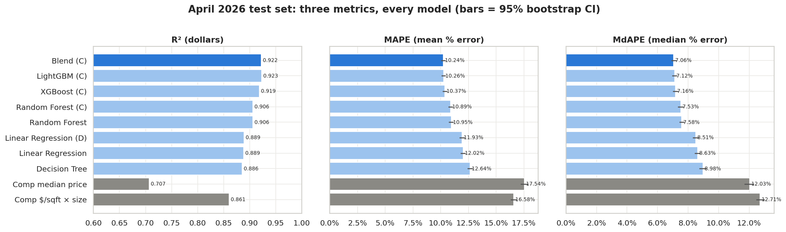

# California Home Price Prediction

Predicting the sale price of single-family homes in California from MLS sold records. Built during the IDX Exchange Data Science Internship.

The model is designed to value **any** single-family address, whether or not it is on the market. It uses only information that would be known about a property before it sells, so asking price, days on market and other listing-process fields are never inputs.

**Best model:** an equal blend of LightGBM and XGBoost (gradient boosting) with school district features, with a **7.06% median error** on April 2026 sales (95% CI 6.90–7.23%, R² 0.922). 63.6% of its predictions land within 10% of the actual sale price.


*Median and mean error, R² and hit rate for every model on April 2026 test homes (Week 8).*

## Results

All models are trained on January 2025 – March 2026 and tested once on April 2026 sales (12,175 homes).

| Model | Features | Median error (MdAPE) | R² | Within 10% of sale price |
| --- | --- | --- | --- | --- |
| Reference: median price of nearby recent sales | none (no model) | 12.0% | 0.707 | 43.8% |
| Reference: nearby price per sq ft × living area | none (no model) | 12.7% | 0.861 | 40.5% |
| Linear Regression (baseline) | Original 24 | 8.6% | 0.889 | 56.2% |
| Linear Regression | + home shape + school district | 8.5% | 0.889 | 56.4% |
| Decision Tree | Original 24 | 9.0% | 0.886 | 54.0% |
| Decision Tree | + school district | 9.1% | 0.885 | 54.0% |
| Random Forest | Original 24 | 7.6% | 0.906 | 60.9% |
| Random Forest | + school district | 7.5% | 0.906 | 61.2% |
| XGBoost | + school district | 7.16% | 0.919 | 63.2% |
| LightGBM | + school district | 7.12% | 0.923 | 63.5% |
| **Blend: 50% LightGBM + 50% XGBoost** | **+ school district** | **7.06%** | **0.922** | **63.6%** |

The ranking is the same on every metric and at each of three earlier cutoffs (January, February and March 2026), so it is not specific to April: boosted models, then Random Forest, Linear Regression, Decision Tree, and the no-model references last.

- **Gradient boosting (Week 7) is the first real step up since the Random Forest.** A paired bootstrap puts the blend 0.47 points ahead of the Random Forest (95% CI 0.31–0.62), and it beats the Random Forest at every cutoff. Median bias shrinks from −1.4% to −0.6%. Settings were tuned on the January–March validation months (LightGBM: 255 leaves, learning rate 0.025, 3,000 trees; XGBoost: depth 10, learning rate 0.05, 750 trees), and blend weights were picked the same way.
- **School district features help only slightly.** ZIP, city and nearby sales already describe location in fine detail, so district boundaries add little new information (about 0.05 points, within noise).
- **The mean error (MAPE, 10.2%) is about 1.45× the median** for every model. Most homes are valued within a few percent, but a small tail is missed by 30%+: the worst 5% of homes account for 22% of all percentage error.

The full metric set with confidence intervals (MAPE, MAE, RMSE, bias, share within 5/10/20%) is in [`results/metrics_summary.csv`](results/metrics_summary.csv). Breakdowns by price band, county, size, age and comp distance are in [`results/metrics_by_segment.csv`](results/metrics_by_segment.csv).

### Where the model is accurate (Week 8)

| Segment | Best | Worst |
| --- | --- | --- |
| Sale price | $450K–$910K: 5.5–5.9% MdAPE, 72–75% within 10% | $2.3M+: 11.4% MdAPE, 45% within 10% |
| Home age | 0–10 years: 5.0% | over 70 years: 9.2% |
| Living area | 1,500–2,000 sq ft: 6.4% | 3,500+ sq ft: 10.4% |
| Distance to nearby sales | closest fifth: 6.1% | farthest fifth: 8.5% |
| County | Riverside 5.7%, San Bernardino 5.8% | Alameda 10.0% |

Banded by *actual* price, the model looks too high on cheap homes (+1.6%) and too low on expensive ones (−4.5%). Banded by *predicted* price, which is what a user sees, the bias is flat (−0.3% to −0.9% in every band), so most of that pattern is regression to the mean rather than a systematic error. Accuracy is still genuinely lower at the top end.

**Takeaway:** the model is reliable for typical homes ($450K–$1.1M, under 50 years old, with nearby sales) and should come with a wider confidence range for luxury, very old, very small or isolated homes. Condition and renovations are not in the data, which likely explains much of the error on older homes.

## Approach

- **Data:** 28 months of California Regional MLS (CRMLS) sold records, January 2024 – April 2026: 615,707 sales, of which 309,735 are single-family homes.
- **Cleaning:** removes duplicate sales, homes outside California and impossible values (such as under 300 sq ft or more than 20 bedrooms), then price outliers. Price outlier cutoffs are learned from the training data only.
- **Features (24):** size, bedrooms, bathrooms, lot size, age, parking, HOA fee, pool, view, fireplace, location (coordinates, county, city, ZIP, school district) and season. Three neighborhood features summarize the 10 nearest sales from the previous 12 months, using only months strictly before each home's own sale.
- **Engineered features (Week 6):** home shape (bedrooms per bathroom, square feet per bedroom, lot size relative to living area), plus a school district layer. Each home's coordinates are matched to the official California Department of Education 2024–25 district boundaries. This gives every home its elementary and high school district, which the MLS field leaves blank for a third of homes, along with district attributes such as enrollment density and the share of disadvantaged students. Race and ethnicity fields are deliberately excluded.
- **Target:** log of sale price, since prices are heavily right-skewed. Predictions are converted back to dollars before scoring.
- **Models:** Linear Regression, Decision Tree, Random Forest, LightGBM and XGBoost, plus a weighted average of model predictions on the log scale. Weights and all hyperparameters are chosen on validation months, never on the test month.
- **Train/test split:** by time, not at random. The 15-month training window was chosen by testing windows of different lengths on the January–March 2026 validation months.
- **Evaluation:** median absolute percentage error (MdAPE) is the headline metric, following standard automated valuation model (AVM) practice. MAPE, R², hit rates and bootstrap confidence intervals are reported alongside it, and error is broken out by price band, county, home size, age and distance to nearby sales.

## Progress

| Week | Work | Where |
| --- | --- | --- |
| 1 | Dataset access confirmed; key columns and their planned use | [`docs/week1_dataset_access_and_key_columns.docx`](docs/week1_dataset_access_and_key_columns.docx) |
| 2 | Data exploration | [`notebooks/01_exploration.ipynb`](notebooks/01_exploration.ipynb) |
| 3 | Cleaning, feature building, train/test split | [`notebooks/02_preprocessing.ipynb`](notebooks/02_preprocessing.ipynb) |
| 4 | Linear Regression baseline | [`notebooks/03_baseline_model.ipynb`](notebooks/03_baseline_model.ipynb) |
| 5 | Decision Tree and Random Forest | [`notebooks/04_model_comparison.ipynb`](notebooks/04_model_comparison.ipynb) |
| 6 | Engineered features and the school district layer | [`notebooks/04b_feature_engineering.ipynb`](notebooks/04b_feature_engineering.ipynb) |
| 7 | Gradient boosting (LightGBM, XGBoost), tuning and blending | [`notebooks/05_advanced_models.ipynb`](notebooks/05_advanced_models.ipynb) |
| 8 | Evaluation: MAPE, MdAPE, confidence intervals, error by price band and segment | [`notebooks/06_evaluation.ipynb`](notebooks/06_evaluation.ipynb) |

Next (optional, Week 9): serve the saved LightGBM and XGBoost pipelines in a Streamlit app.

## Repository layout

| Path | Contents |
| --- | --- |
| `notebooks/` | One notebook per week |
| `py/preprocessing.py` | Cleaning and feature code, used by every notebook from Week 3 on |
| `py/modeling.py` | Shared training and evaluation helpers, used from Week 4 on (including the Week 7 boosting and staged-prediction helpers) |
| `py/feature_engineering.py` | Week 6 home-shape features and the school district spatial join |
| `py/build_processed.py` | Rebuilds `processed/` from the raw files without opening a notebook |
| `processed/` | Model-ready training data (155,216 rows) and test data (12,175 rows), the preprocessing settings, and the school district for every home (`school_district_join.csv.gz`) |
| `models/` | Saved Linear Regression, Decision Tree, LightGBM (27 MB) and XGBoost (14 MB) pipelines. Each takes raw columns and predicts a sale price. The Random Forest (~190 MB) is not saved; rerun the Week 5 notebook to rebuild it |
| `results/` | Metrics, backtests, error breakdowns and test-set predictions for every model |
| `figures/` | Charts produced by each notebook |
| `docs/` | Written notes |

## Running it

Requires Python 3.10 or later.

```
pip install -r requirements.txt
```

`processed/train.csv` and `processed/test.csv` are included, so models can be trained without the raw data.

The raw monthly CRMLS files are not included. They are provided to IDX Exchange interns. To rebuild everything from scratch, put the `CRMLSSold*.csv` files in a `csv/` folder at the top level and run:

```
python3 py/build_processed.py
```

This also creates two files that are too large or regenerable to commit: `processed/sold_sfr_clean.csv`, needed by the Week 4–7 notebooks, and `processed/preprocessor.joblib`, needed by the Week 4 notebook.

The Week 6 notebook also needs the *California School District Areas 2024-25* boundary file (GeoJSON, 45 MB), a public download from the California Department of Education. Save it in the top-level folder or in `geo/`. The district for every home is already in `processed/school_district_join.csv.gz`, so the boundary file is only needed to redo the spatial join.

The Week 7 notebook takes about 85 minutes on 2 CPU cores, mostly for the tuning grid. The Week 8 notebook refits nothing: it reads the saved test predictions in `results/` and runs in under a minute.
